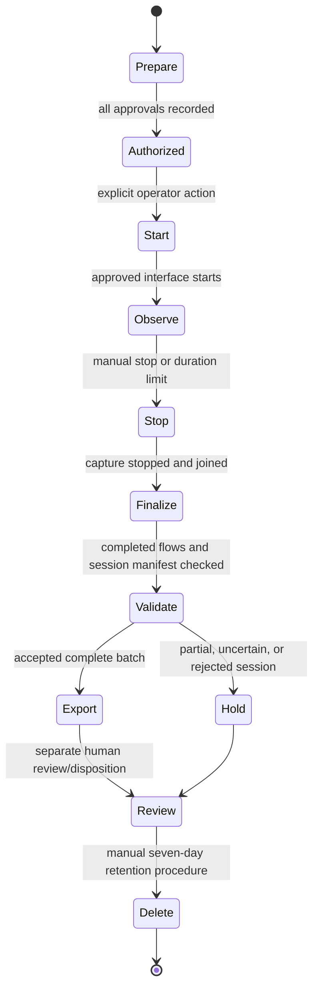

# live_flow_v1 Capture-Facing Session Coordinator Design

## Status and boundary

This is a design-only document. No capture-facing session coordinator exists in
the repository. `NetworkMonitor` can start metadata capture only after an
explicit call to `start_capture()`, while
`export_completed_flows_offline()` converts caller-supplied completed flows and
publishes an offline batch. There is no call path between them.

The Phase 4 live-inference compatibility gate remains unchanged and closed. A
future coordinator must not call `IDSService`, a model, SQLite event storage,
or the dashboard as part of export handling.

The terms **current**, **proposed**, and **unresolved** below distinguish source
code behavior, intended future behavior, and matters requiring evidence or
human approval.

## Current components

- **NetworkMonitor:** capture is opt-in through `start_capture()`. It discovers
  interfaces, marks only USB-checker-matched interfaces approved, and refuses
  an unapproved or unavailable selection. `stop_capture()` stops and joins the
  sniffer before returning.
- **LiveFlowAggregator:** receives payload-free `PacketRecord` objects and
  emits `CompletedFlow` records. It emits `idle_timeout` for idle flows and can
  finalize all active flows with a caller-supplied reason.
- **Dashboard:** currently calls `finalize_all("monitor_stopped")` after a
  normal stop and `finalize_all("dashboard_closed")` while closing. Its existing
  completion callback goes to `IDSService`, not the offline workflow.
- **Adapter and exporter:** the adapter accepts only `idle_timeout` and
  `monitor_stopped`; the offline workflow converts a supplied batch before it
  invokes the existing validated, staging-directory exporter.

## Proposed session lifecycle

### Prepare and explicitly authorize

**Proposed:** the operator prepares explicit `CollectorMetadata`,
`SessionManifest`, an existing approved output directory, maximum duration, and
session/scenario identifiers. The manifest uses timezone-aware actual start and
end times; its retention deadline remains exactly seven days after the recorded
end time.

Capture can begin only after a human records approval for the laptop, USB
adapter/interface, network scope, duration, scenario, output root, privacy
rules, responsible person, and deletion owner. Application startup, interface
discovery, or a successful USB check must never itself authorize or start
capture.

**Required before implementation:** define an in-memory session owner and its
result states (`prepared`, `observing`, `held`, `rejected`, `exported`). It must
have no default output path and no automatic start behavior.

### Start and observe

**Current:** `NetworkMonitor.start_capture()` is an explicit operation and
rechecks approved interfaces before starting. Packet callbacks receive parsed
metadata rather than retained packet payloads.

**Proposed:** a separately reviewed coordinator may subscribe only after
explicit authorization and only for the session duration. It forwards metadata
to an aggregator instance owned by that session. It must not export individual
flows immediately, infer labels, or call IDS/model code.

**Required before implementation:** define subscription/removal ordering so a
failed start does not leave a callback registered or a session marked active.

## Approved USB interface confirmation

**Current:** `USBAdapterChecker` reads the existing device policy and determines
whether a detected USB Wi-Fi adapter matches an approved device identity.
`NetworkMonitor.discover_interfaces()` compares the approved result's interface
name, description, and adapter name with discoverable Scapy interface metadata,
then marks matching interfaces `approved`. `start_capture()` resolves only from
that approved set and has no fallback to a WAN Miniport or another interface.

**Proposed:** before every authorized session, rediscover interfaces, display
the matched approved interface to the operator, and record only the approved
interface category in the export manifest. Do not add the raw interface name,
IP address, MAC address, device ID, or endpoint details to feature records.

**Required before an authorized pilot:** verify the approved USB adapter and
selected capture interface in the approved environment. Device policy and
network configuration remain read-only inputs to this design.

## Completion, stop, and interruption handling

| Case | Current behavior | Proposed coordinator disposition |
| --- | --- | --- |
| `idle_timeout` | Aggregator emits a completed flow; adapter/exporter accept it. | Retain it in the active in-memory session; it does not end the session. |
| `monitor_stopped` | Dashboard stops the monitor, then finalizes active flows; adapter/exporter accept it. | Record actual end after capture has stopped and joined; validate/export after accepted flows are processed. |
| `dashboard_closed` | Dashboard finalizes active flows with this value; adapter rejects it. | Hold or exclude the session. Do not rename or coerce this reason. |
| Capture, process, or stop interruption | Monitor can report an error; no export contract establishes successful completion. | Mark the session incomplete/uncertain and do not claim a completed export. |
| Export failure | Exporter raises and cleans current staging where feasible. | Report `export_failed`; retry only after reviewing error and session/lock state. |

**Required before implementation:** decide whether held session data remains
only in memory or is discarded. No automatic stale-lock or staging cleanup is
permitted.

## Metadata, privacy, and review separation

**Current:** feature records contain ordered schema values, explicit
missingness, collector/session metadata, flow ID, and finalization reason.
They do not export endpoint IPs, ports, packet payloads, credentials, labels,
or human dispositions. The exporter allow-lists manifest and configuration
fields and requires a caller-supplied existing output root.

**Proposed:** maintain a separate, access-controlled control/review record for
authorization evidence, scenario provenance, operator, session boundaries,
quality findings, uncertainty, exclusion, and any later label evidence. A
planned benign scenario is not a verified label for every flow.

**Required before an authorized pilot:** approve who can read, export, delete,
or maintain this separate record; define backup/sync handling and any narrowly
approved troubleshooting identifier process.

## Safe stop and duration limits

**Current:** `stop_capture()` attempts to stop and join the capture thread and
reports a `NetworkMonitorError` if it cannot stop cleanly. No session-duration
timer or automatic stop exists.

**Proposed:** the coordinator receives an explicitly approved maximum duration,
shows it to the operator, and requires a manual stop procedure. Reaching the
limit should request an orderly stop, record whether it completed, and never
silently treat a failed stop as a clean `monitor_stopped` session.

**Required before implementation:** define clock source, duration enforcement,
operator notification, and behavior when stop/join fails. These choices need a
separate review because they affect capture lifecycle behavior.

## Export, review, and deletion

**Current:** the offline workflow accepts explicit completed flows, collector
metadata, manifest, and output root. It converts all flows before calling the
exporter. The exporter validates the batch, protects session collisions with a
lock, writes staging files, and publishes one session directory by rename. It
does not schedule retention deletion. `delete_export()` is explicit and writes
a receipt only after the session directory is absent.

**Proposed:** only an accepted, explicitly finalized session batch is passed to
the workflow. A successful result means that batch was published; it does not
mean the session has been reviewed or labeled. Review/disposition remains
outside feature records. Deletion remains a manual, reviewed action at the
seven-day deadline and must include receipt and backup/sync verification.

**Required before an authorized pilot:** rehearse export failure, lock collision,
manual recovery, and deletion procedures in a non-production Windows directory.
The current disposable-temporary-directory harness cannot validate a
user-selected directory, removable drive, network share, or pilot storage.
That future validation requires a separately designed, reviewed, and authorized
component.

## Staged implementation and test plan

1. **Before implementation:** approve this coordinator design, session-owner
   API, callback lifecycle, duration behavior, held-session behavior, and
   failure result structure.
2. **Before implementation:** add isolated tests using constructed in-memory
   `PacketRecord`/`CompletedFlow` fixtures and temporary output directories.
   Test explicit authorization rejection, callback cleanup, normal stop,
   `idle_timeout`, `dashboard_closed`, failed stop, invalid batch, exporter
   failure, and no IDS/database/model/UI side effects.
3. **Before an authorized pilot:** validate approved-interface matching and
   storage behavior on the selected Windows environment. Test permissions,
   lock collision, interruption recovery, and reparse-point behavior without
   using pilot data.
4. **Before collection:** obtain written authorization and perform a small,
   manually started benign-only session. Keep the Phase 4 gate closed.
5. **Before model evaluation:** use separately approved provenance, quality,
   exclusion, duplicate, and split-isolation procedures. Do not infer labels
   from scenario names.

## Go/no-go criteria and unresolved approvals

### No-go today

- No capture-facing coordinator is implemented or connected to the monitor.
- Network scope, duration, responsible person, storage roles, retention owner,
  quality thresholds, and review process are not approved.
- Windows reparse-point, crash/interruption, and future approved-storage behavior are
  not verified.
- The Phase 4 compatibility gate remains closed for live inference.

### Required approvals before a pilot

- Laptop, approved USB interface, owned/authorized network, maximum duration,
  manual stop procedure, responsible person, and approval date.
- Output root, access roles, backup/sync controls, retention/deletion owner,
  receipt evidence location, and troubleshooting-identifier policy.
- Scenario definition/version, provenance record, incomplete/mixed/uncertain
  session disposition, and measurable quality acceptance thresholds.
- Reviewed coordinator implementation and passing isolated/Windows validation
  evidence.

### Unresolved questions

- Who owns the proposed in-memory session buffer and who may invoke export?
- What operator-facing mechanism reports held, rejected, or export-failed
  sessions without altering dashboard behavior prematurely?
- What storage volume and access controls are approved, including backups and
  sync copies?
- What outcome should apply if a duration-limit stop cannot join the capture
  thread?

No answer is inferred by this document, and no collection is authorized.
