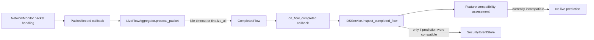

# live_flow_v1 future export integration boundary

## Status

This is a design document only. It does not authorize collection or connect the
offline exporter to packet capture. Current code remains intentionally
disconnected from live_flow_v1 publishing and live IDS inference remains gated.

## Verified current call graph

The repository currently has two separate paths:

Evidence:

- `dashboard_window.py` constructs `LiveFlowAggregator` with
  `IDSService.inspect_completed_flow` as its completed-flow callback and passes
  `LiveFlowAggregator.process_packet` to the monitor.
- `flow_aggregator.py` creates `CompletedFlow` records on idle expiry and on
  `finalize_all`; it calls the configured callback for each completed flow.
- `ids_service.py` checks compatibility before a prediction path can run.
  Current compatibility tests show the Phase 4 schema remains incompatible for
  live inference.
- `live_flow_schema.py` can convert a caller-supplied `CompletedFlow` to a
  `LiveFlowV1Record`, but it is called only in schema/export tests.
- `live_flow_export.py` is called only in exporter tests. It is not imported by
  the monitor, aggregator, dashboard, IDS service, or event store.

The integration is therefore absent immediately after `CompletedFlow` is
finalized and before any live_flow_v1 conversion or export occurs.

## Proposed boundary

### Inputs owned by the future caller

A future, separately authorized coordinator should receive a completed flow
from the aggregator and must be passed all of the following explicitly:

- a `CollectorMetadata` instance containing the approved session ID and the
  collector's configured idle timeout;
- a `SessionManifest` containing the approved scenario/session metadata,
  actual session times, retention deadline, schema/collector versions, and
  limited collector configuration; and
- an existing caller-selected output root for `LiveFlowExportStore`.

There must be no default output directory, no implicit production database
path, no inferred scenario, no inferred label, and no automatic interface
selection at this boundary.

### Proposed responsibilities

The repository now has a narrow offline coordinator,
`export_completed_flows_offline()`, that implements the batch conversion and
publication portion below for explicitly supplied in-memory flows. It remains
unconnected to capture and is exercised only by temporary-directory tests. A
future capture-facing coordinator may:

1. accept only a `CompletedFlow` emitted by the existing aggregator;
2. convert it through the existing schema conversion contract using the
   caller-supplied `CollectorMetadata`;
3. hold resulting records in session-local memory until the caller explicitly
   finalizes the approved session; and
4. submit the complete supplied record batch with its supplied manifest and
   output root to the existing offline exporter.

It must not create packet capture, choose a network interface, enrich records
with endpoint identifiers, write SQLite events, assign labels, or invoke model
prediction.

The offline workflow returns a result only after successful publication. A
future capture-facing coordinator should report a structured result to its caller with a
clear distinction between: records accepted in memory, records rejected by
schema/export validation, export failure, and successful published session.
It must never claim publication when `LiveFlowExportStore.export()` raises.

## Failure, session, and recovery behavior

- Invalid records or manifests must remain rejected as reported by the existing
  exporter validation report. A rejected batch must not become a partial
  session directory.
- A partial, mixed, uncertain, interrupted, or scope-ambiguous session must
  stay outside the feature export disposition. Its review/disposition belongs
  in the separately controlled pilot review record.
- Duplicate session IDs, existing session directories, active same-session
  locks, and existing deletion receipts are existing exporter errors. A future
  caller must surface those errors and must not choose a replacement session ID
  automatically.
- Stale locks and abandoned staging directories require the documented manual,
  reviewed recovery procedure. No integration may add automatic cleanup.
- A deletion receipt is written only after the target export directory is
  absent. If deletion or receipt publication fails, the caller must report the
  failure and preserve recovery evidence; it must not report a completed
  deletion.

## Privacy and review boundary

`LiveFlowV1Record` exports only schema/collector/session metadata, flow ID,
finalization reason, ordered feature values, and explicit missingness. The
future boundary must never export or add:

- endpoint IP addresses or ports;
- raw payloads, credentials, message contents, or packet files;
- labels, attack/benign claims, detector results, or alert severity;
- free-text operator notes; or
- unapproved configuration, device, or troubleshooting identifiers.

Session review, authorization references, scenario evidence, uncertainty,
operator records, backup/sync inventory, and future labels remain in separate
access-controlled records linked only by approved opaque IDs. A scenario ID
describes intended context; it does not mark each flow benign.

## IDS compatibility boundary

The export path is an offline data-collection concern. It must neither call
`IDSService.inspect_completed_flow` nor change its behavior. Conversely, the
existing IDS callback must not be interpreted as an export operation.

`feature_compatibility.py` and IDS-service tests establish that the current
Phase 4 model cannot receive live predictions because required training-feature
semantics are not available. Converting a completed flow to live_flow_v1 does
not create those missing Phase 4 features. No future exporter integration may
bypass the compatibility assessment, load a model, or activate live inference.

## Staged implementation plan

1. **Authorization and storage review:** complete pending scope, interface,
   duration, access, retention, review-owner, and quality-threshold approvals.
2. **Windows storage validation:** in an authorized non-production directory,
   test the selected filesystem's permissions, reparse-point behavior,
   interruption recovery, locks, rename behavior, and deletion receipts.
3. **Boundary-only tests:** add unit tests that feed completed flows directly
   to the proposed coordinator with explicit in-memory session inputs. Verify
   that it has no capture startup, no SQLite write, no IDS call, no label, and
   no output default.
4. **Failure/disposition tests:** verify invalid conversion, export failure,
   duplicate session collision, active/stale lock handling, and uncertainty
   reporting do not claim success or cause automatic cleanup.
5. **Separate implementation approval:** review the coordinator design and
   tests before wiring it to any approved capture lifecycle.
6. **Controlled pilot authorization:** only after the preceding approvals and
   validation evidence exist, authorize a limited benign-only session under the
   collection protocol.

## Go/no-go criteria

### No-go today

- The exporter has no live capture call path.
- Network/device scope, responsible people, storage permissions, retention
  owner, deletion evidence, and quality thresholds remain unapproved.
- Directory-junction rejection is tested only in temporary directories.
  Symlink creation, other reparse-point types, real ACL denial, and
  interrupted-operation behavior are not verified in the intended Windows
  storage environment.
- The Phase 4 live-inference compatibility gate remains closed.

### Required before an operational pilot

- Explicit written authorization for laptop, approved USB interface, network,
  time window, and maximum duration.
- Approved caller-selected storage root, roles, backup/sync controls,
  troubleshooting-identifier policy, seven-day deletion procedure, and receipt
  evidence location.
- Approved scenario catalogue, session review/disposition process, and
  measurable quality thresholds.
- Runtime validation evidence for the selected Windows filesystem and a
  separately reviewed boundary implementation with its test results.

## Unresolved platform risks

The current code and tests do not establish behavior under Windows junctions
or other reparse points, process crash/power loss, antivirus/file-indexer
interference, real multi-process contention, removable/network storage, or
manual recovery mistakes. The export design intentionally makes no universal
crash-durability claim. These risks require controlled environment validation;
they must not be treated as resolved by this design document.
