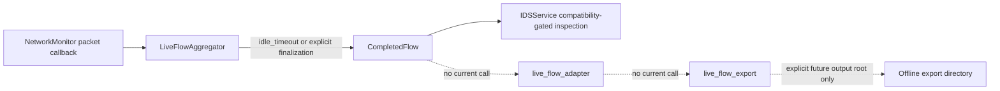

# live_flow_v1 Offline Integration Review

## Status and scope

This is a design review only. The repository has no call path from packet
capture, `LiveFlowAggregator`, or the dashboard to the offline exporter. It
does not authorize collection, create a collection command, or enable live IDS
inference.

Terms used in this document:

- **Verified** describes behavior present in the reviewed source code.
- **Proposed** describes a future integration design.
- **Unverified** requires a platform test or an explicit human decision.

## 1. Current flow lifecycle and the missing boundary

### Verified lifecycle

`LiveFlowAggregator` creates a `CompletedFlow` using a first-observed-packet
direction convention. It can finalize idle flows with `idle_timeout`; the
dashboard also finalizes outstanding flows when monitoring stops or when the
dashboard closes. The current completion callback is used by `IDSService`.

`completed_flow_to_live_flow_v1()` is a pure, in-memory conversion boundary.
It accepts a completed flow and explicit `CollectorMetadata`, returns a
`LiveFlowV1Record`, and does not write files or call the exporter. The exporter
accepts an explicit `SessionManifest`, a batch of records, and an existing
caller-provided output root. No reviewed call site joins these components.

`offline_flow_export_workflow.py` now provides a caller-controlled, in-memory
coordinator for an explicitly supplied batch. It converts every supplied
`CompletedFlow` through the adapter before it invokes the exporter. It has no
production call site and is not connected to `NetworkMonitor`,
`LiveFlowAggregator`, the dashboard, or `IDSService`. A future operational
boundary would still need to decide which completed records belong to a session,
retain them within an approved collection process, validate disposition, and
call this offline workflow deliberately.

**Recommendation — before implementation:** define that coordinator as an
opt-in component with no default output path, no automatic startup, and no
connection to live IDS inference.

## 2. Proposed caller responsibilities

The current offline workflow requires its caller, rather than the adapter or
exporter, to supply and validate:

- a unique opaque session ID and versioned scenario ID;
- `CollectorMetadata` matching the active schema, collector version,
  orientation convention, and configured idle timeout;
- a `SessionManifest` with timezone-aware actual start/end timestamps,
  interface category, permitted collector configuration, and the retention
  deadline exactly seven days after the recorded actual end;
- an existing, approved output directory and the authorization to write there;
- a decision to export, hold for review, or exclude an incomplete, mixed, or
  uncertain session; and
- a separate review/disposition record, if one is needed.

The adapter has no `SessionManifest` or output-directory parameter. The
exporter has no capture/session controller. That separation is intentional and
must remain explicit.

**Recommendation — before implementation:** specify the coordinator API and a
structured result for converted, rejected, held, and exported records.

**Recommendation — before an authorized pilot:** approve the output directory,
access roles, network/interface scope, maximum duration, session procedure,
and privacy rules.

## 3. Export publication and partial failures

### Verified behavior

`LiveFlowExportStore.export()` validates the manifest and the complete supplied
batch before publication. It then acquires a per-session lock, writes manifest,
record, and summary files to a private staging directory below the explicit
output root, and publishes the session directory with a rename. A validation or
ordinary write failure raises an error, removes the current operation's staging
directory where possible, and releases its lock. An existing completed session
is rejected rather than overwritten.

This gives an all-or-nothing result for one exporter invocation: it either
publishes that supplied batch directory or reports failure. It does **not** make
capture-to-session collection transactional. A process termination, power
failure, filesystem fault, or platform-specific rename behavior can leave a
stale lock or abandoned staging directory. The implementation does not claim
universal crash or power-loss durability.

**Recommendation — before implementation:** make the coordinator export only a
deliberately finalized batch and report any conversion/export failure as
incomplete, without claiming that the session was exported.

**Recommendation — before an authorized pilot:** rehearse reviewed manual
recovery in the chosen Windows storage location and preserve evidence before
any stale lock or staging directory is removed.

## 4. Completion reasons and interrupted sessions

The adapter currently accepts only `idle_timeout` and `monitor_stopped` as
`CompletedFlow.finalized_reason` values. It must not reinterpret or silently
map any other value.

| Completion case | Current behavior | Proposed disposition |
| --- | --- | --- |
| `idle_timeout` | Accepted by the adapter. It describes flow finalization, not session completion. | Retain only within an otherwise reviewed session. |
| `monitor_stopped` | Accepted by the adapter. | Record the session end and review whether the stop was planned. |
| `dashboard_closed` | Dashboard can emit this reason; the adapter rejects it. | Hold/exclude until a future, separately reviewed contract defines its treatment. Do not rename it. |
| Capture/process interruption | No adapter conversion rule establishes successful session completion. | Mark the session incomplete or uncertain; do not publish it as a completed pilot session without review. |

**Recommendation — before implementation:** define a coordinator-side policy
for rejected completion reasons and interrupted sessions. Do not expand the
adapter's accepted reasons without a focused schema and test review.

**Recommendation — before an authorized pilot:** approve the manual stop and
interruption disposition procedure.

## 5. Duplicate handling, locks, and recovery

### Verified behavior

- The exporter rejects duplicate flow IDs in a supplied batch.
- A completed session directory and a deletion receipt are never overwritten.
- A session lock prevents ordinary concurrent export/delete operations using
  the same session ID while that lock exists.
- Deletion validates the root/session path, obtains the lock, removes the
  intended session directory, confirms it is absent, then creates a receipt.
  A receipt is not written before successful deletion.

### Limits

Duplicate detection is limited to an export batch; there is no implemented
cross-session duplicate analysis. Stale locks and abandoned staging directories
are intentionally not cleaned automatically. The documented recovery procedure
requires a stopped exporter, inspection of the session artifacts, evidence
preservation, backup, and escalation of ambiguous ownership or partial
deletion. Windows reparse-point behavior and interruption recovery need local
runtime verification.

**Recommendation — before an authorized pilot:** assign a recovery owner and
test the manual procedure on the approved Windows output volume without real
pilot data.

**Recommendation — before model evaluation:** define cross-session duplicate
and related-session checks so evaluation splits do not overstate performance.

## 6. Features versus review and disposition

The exported `LiveFlowV1Record` contains ordered feature values, explicit
missingness, schema/collector metadata, a session ID, flow ID, and flow
finalization reason. It does not contain a verified benign/attack label.

Scenario planning and human review are separate from features. A planned benign
scenario does not prove that every observed flow is benign. Any future review,
disposition, or label artifact must link by session/flow IDs outside the feature
record and preserve evidence, reviewer, confidence, and exclusion decisions.

**Recommendation — before an authorized pilot:** approve a separate review and
exclusion record format; it must not be embedded in exported feature columns.

**Recommendation — before model evaluation:** approve label provenance,
uncertainty handling, and train/validation/test session isolation.

## 7. Privacy and data minimization

The adapter uses endpoints and ports only as source data for permitted derived
features such as directional counts and `is_sm_ips_ports`; it does not export
the endpoint addresses or ports. The exporter validates a narrow manifest,
configuration, feature, and missingness allowlist. It rejects unexpected fields
and does not accept payloads, credentials, labels, endpoint identifiers, or
free-form operator notes in records. `operator_notes_reference` is an opaque
reference, not note content.

The code cannot control copies made outside the chosen output root, backups,
sync services, or operating-system metadata. Access permissions and any
temporary troubleshooting identifier process remain human decisions.

**Recommendation — before an authorized pilot:** approve storage access roles,
backup/sync handling, deletion evidence, and any exception for troubleshooting
identifiers.

**Recommendation — before model evaluation:** review whether approved derived
features and metadata remain adequate and privacy-preserving for the proposed
research question.

## 8. Retention and deletion

The manifest validator requires `retention_delete_after` to equal the actual
session end plus seven 24-hour days. This records a deadline only. There is no
automatic retention scheduler or deletion enforcement path.

`delete_export()` is an explicit, caller-initiated operation. It confines
deletion to a validated session under an explicit existing root and writes a
deletion receipt only after it confirms the session directory is absent. It
does not verify deletion from backups, sync targets, or copied files.

**Recommendation — before an authorized pilot:** approve the deletion owner,
manual schedule, receipt review, and backup/sync deletion procedure.

## 9. Phase 4 IDS compatibility gate

The Phase 4 model, its artifact, and its feature-compatibility gate remain
unchanged. The compatibility audit found only `proto` and `is_sm_ips_ports`
semantically compatible with the current metadata-only live flow pipeline.
Consequently the live prediction gate remains closed. The adapter and exporter
do not call `IDSService`, the model, or the compatibility gate.

**Recommendation — before implementation:** preserve this separation in any
coordinator and add a regression test proving it cannot trigger inference.

**Recommendation — before model evaluation:** use a separately authorized,
compatible data and evaluation design; offline export alone does not make the
42-feature model valid for live traffic.

## 10. Staged implementation plan

1. **Offline workflow (implemented and tested):** the opt-in workflow converts
   a full in-memory batch before calling the exporter. Temporary-directory
   tests cover conversion rejection, exporter failure, duplicate flow IDs,
   collision handling, retries, and `dashboard_closed` rejection.
2. **Operational coordinator (before implementation):** define session
   buffering, hold/exclusion outcomes, and any operator-facing result without
   connecting dashboard or IDS behavior. Do not make capture automatic.
3. **Pilot readiness (before an authorized pilot):** obtain all approvals,
   freeze schema/collector versions and quality thresholds, verify the selected
   Windows output volume, and rehearse manual recovery/deletion procedures.
4. **Authorized benign-only pilot (before collection):** separately authorize
   and implement the capture-facing coordinator with manual start/stop. Keep no
   automatic capture, no live inference, and no implied labels.
5. **Evaluation planning (before model evaluation):** review sessions and
   provenance, exclude uncertain data, isolate splits by session/related flows,
   and define a compatible detector study. Do not reuse the Phase 4 gate as
   evidence that these records support its 42-feature model.

## 11. Go/no-go criteria and outstanding approvals

### No-go until all pilot prerequisites are approved and verified

- Authorized laptop, approved external USB Wi-Fi adapter/interface, owned/approved
  network scope, maximum duration, and manual stop procedure.
- Named responsible person, approval date, and explicit authorization to begin.
- Approved output root, access roles, backup/sync handling, retention owner,
  and deletion/receipt verification process.
- Privacy rules for endpoint minimization and any troubleshooting identifiers.
- Frozen manifest/session procedure, schema/collector versions, and approved
  quality thresholds and exclusion rules.
- Windows runtime evidence for the selected output volume, including ordinary
  collision/failure behavior and the disclosed reparse-point limitation.

### Unresolved questions

- Which component will own the future session buffer and how will it expose
  incomplete or held sessions to an operator without changing dashboard or IDS
  behavior?
- What approved storage volume and access control will be used, and how will
  copies outside that volume be discovered and deleted?
- What exact acceptance thresholds will permit a session to pass quality review?
- How will interrupted sessions and `dashboard_closed` completions be reviewed
  without altering the adapter contract?
- What evidence will establish labels and split isolation if a later model
  evaluation is authorized?

Until these questions are answered through the stated approval process, this
review supports design and offline tests only; it does not authorize collection.
